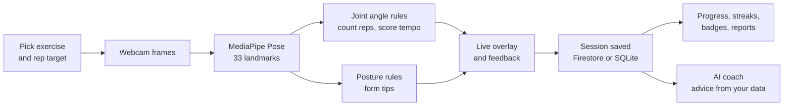
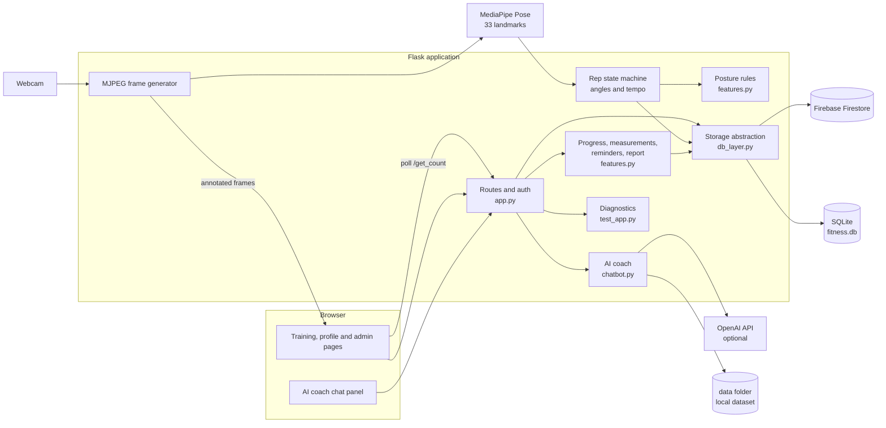
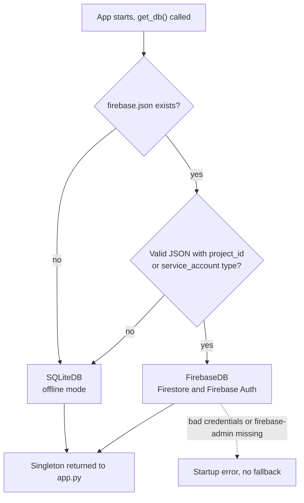
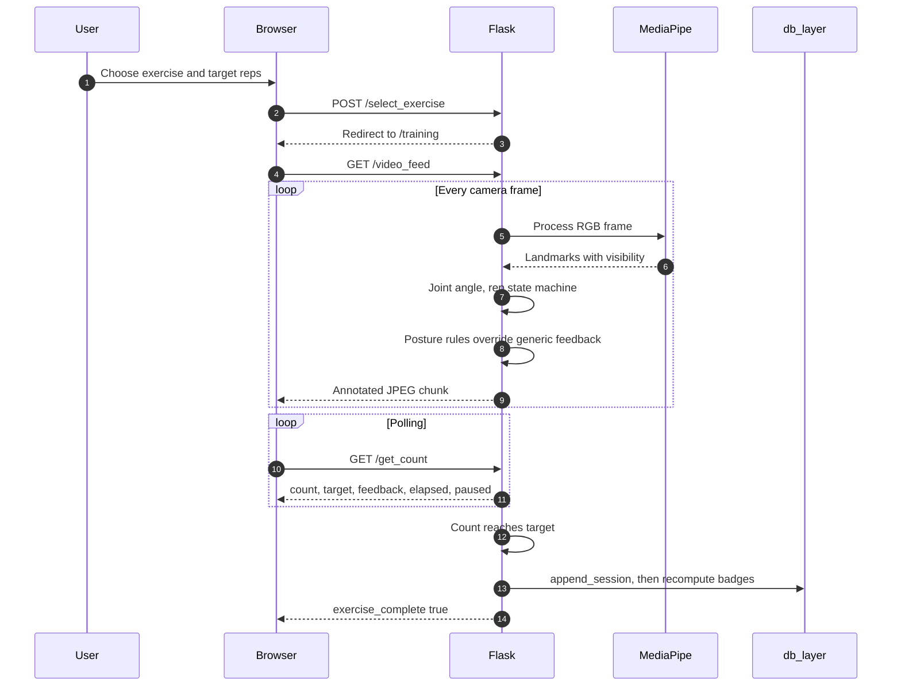
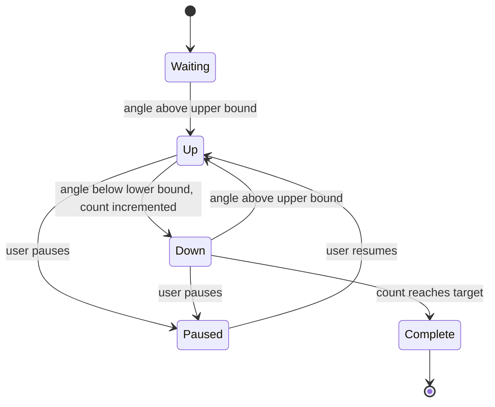
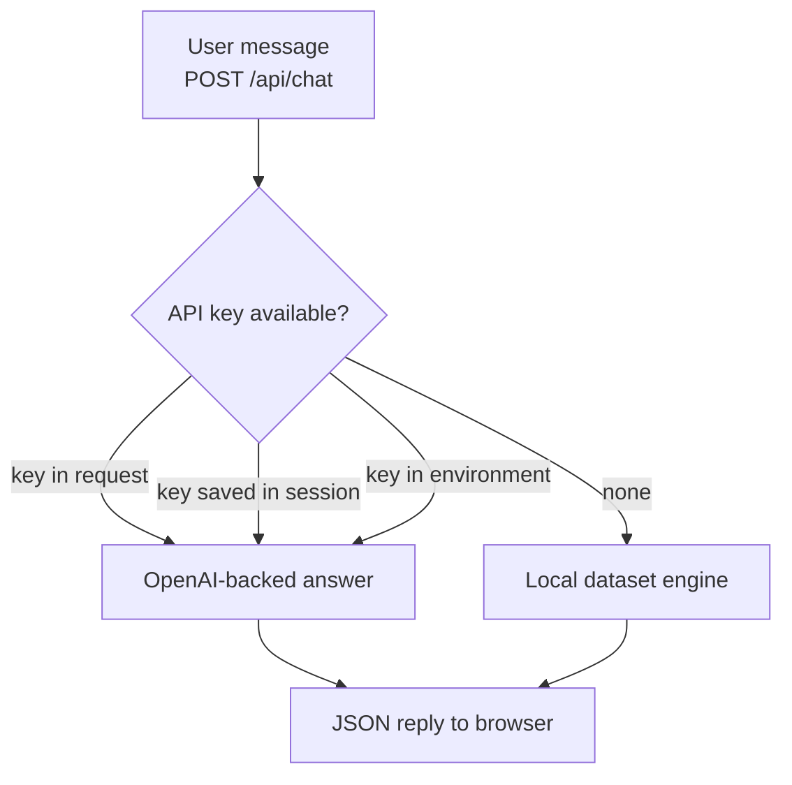
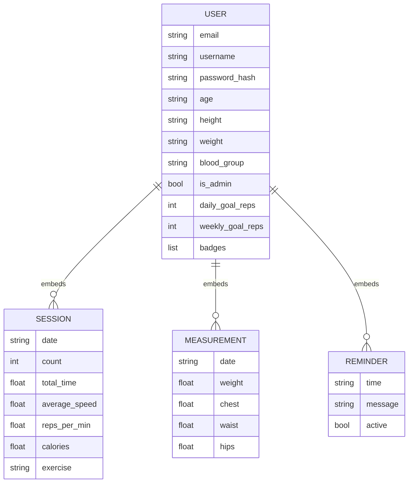
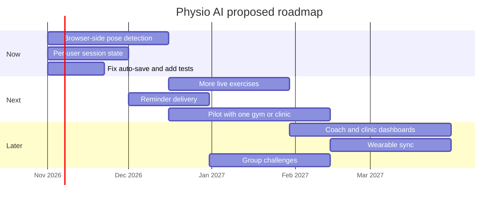

# Physio AI

Real-time exercise tracking and form coaching from an ordinary webcam. Physio AI estimates body pose with MediaPipe, counts repetitions from joint angles, scores tempo, flags posture errors while you move, and keeps your progress in either Firebase Firestore or a local SQLite file, chosen automatically at startup.

Repository: https://github.com/Alexjmathew/AIBOOMI


---

## Table of contents

1. [Problem statement](#problem-statement)
2. [Users and context](#users-and-context)
3. [Solution overview](#solution-overview)
4. [Setup and run](#setup-and-run)
5. [Feature matrix](#feature-matrix)
6. [System architecture](#system-architecture)
7. [Storage backends](#storage-backends)
8. [How a live workout works](#how-a-live-workout-works)
9. [Rep detection and tempo](#rep-detection-and-tempo)
10. [Posture correction rules](#posture-correction-rules)
11. [Calorie estimation](#calorie-estimation)
12. [AI coach](#ai-coach)
13. [Models and data](#models-and-data)
14. [Evaluation and guardrails](#evaluation-and-guardrails)
15. [Data model](#data-model)
16. [Gamification](#gamification)
17. [Route reference](#route-reference)
18. [Project structure](#project-structure)
19. [Configuration](#configuration)
20. [Diagnostics and testing](#diagnostics-and-testing)
21. [Security notes](#security-notes)
22. [Known limitations and risks](#known-limitations-and-risks)
23. [Proposed roadmap](#proposed-roadmap)
24. [Troubleshooting](#troubleshooting)
25. [Contributing](#contributing)
26. [Team](#team)
27. [License](#license)

---

## Problem statement

Exercising at home without a coach means nobody checks your form, counts your repetitions accurately or tells you when your tempo drifts. Poor form can lead to strain and injury, and a lack of feedback is a common reason people stop. Physio AI gives instant, camera-based feedback and a progress record using only an ordinary webcam.

---

## Users and context

| Group | How they use Physio AI | Notes |
|---|---|---|
| Beginners and home exercisers | Live rep counting, tempo and posture tips, streaks and badges | Primary users |
| People doing exercises prescribed by a physiotherapist | A counting and feedback aid between appointments | Supports the professional, never replaces them |
| Students and hackathon reviewers | Demo, admin console, diagnostics page | Runs offline on one laptop |
| Gym or clinic staff (future) | Admin console to add users and review sessions | Basic version exists, dashboards are on the roadmap |

Intended context:

- Indoors, one person in frame, a laptop or desktop webcam at roughly chest height, whole left side of the body visible, facing the right of the image.
- Runs locally. No video leaves the machine. The network is needed only for the optional Firebase and OpenAI features.
- Wellness and training support. It does not diagnose, treat or prescribe, and it is not a medical device.

---

## Solution overview

Home workouts rarely have anyone watching your form, counting reps accurately or giving feedback. Physio AI adds three layers on top of a normal webcam:

| Layer | Responsibility | Implementation |
|---|---|---|
| Perception | Locate 33 body landmarks per frame | MediaPipe Pose |
| Reasoning | Joint angles, rep counting, tempo and form verdicts | Rule engine in `app.py` and `features.py` |
| Experience | Live overlay, dashboards, AI coach chat, admin tools | Flask, Jinja templates, optional OpenAI integration |

Design principles:

- **Explainable.** Every correction comes from a readable rule with a documented threshold.
- **No video stored.** Camera frames are processed in memory and never written to disk. The app does store account and profile data (email, username, age, height, weight, blood group) plus workout history, so protect the database and `firebase.json` accordingly.
- **Runs anywhere.** With no cloud credentials the app falls back to a local SQLite file, so it works offline.

### Solution at a glance



---

## Setup and run

Steps at a glance:

1. Install Python 3.10 or newer and git, and confirm your webcam works in another app.
2. Clone the repository and open a terminal in the project folder.
3. Create and activate a virtual environment.
4. Install the dependencies.
5. Create a `.env` file with a `SECRET_KEY`.
6. Optional: add `firebase.json` for Firestore, or an OpenAI key for the AI coach. Without them the app runs fully offline on SQLite.
7. Start the app with `python app.py` from the project folder.
8. Open http://127.0.0.1:5000, register an account, and optionally promote it to administrator.
9. Choose an exercise and a target. Stand sideways, facing the right side of the image, about two metres from the camera, with your whole left side in frame and good lighting.
10. Optional: sign in as an administrator and open `/admin/tests` to run the built-in checks.

The commands for each step follow.

Requirements: Python 3.10 or newer, a webcam, and a modern browser.

```bash
git clone https://github.com/Alexjmathew/AIBOOMI.git
cd AIBOOMI

python -m venv .venv
source .venv/bin/activate          # Windows: .venv\Scripts\activate

pip install flask opencv-python mediapipe numpy pandas python-dotenv werkzeug
# app.py uses the legacy mp.solutions API. If it is missing in your mediapipe version,
# install an older release that still ships it, and check wheel support for your Python version.
```

Install optional extras only if you use them:

```bash
pip install firebase-admin         # only for Firebase mode
pip install openai                 # only if chatbot.py uses the OpenAI SDK
```

Create a `.env` file in the project root:

```bash
SECRET_KEY=replace-with-a-long-random-string
```

Run it from the project folder (paths are relative to the working directory):

```bash
python app.py
```

Debug mode is off by default. For local development only, enable it with `FLASK_DEBUG=1 python app.py`.

Open http://127.0.0.1:5000 and register an account. With no `firebase.json` present, the console prints that SQLite offline mode is active and creates `fitness.db`.

### Creating the first administrator

New accounts are not admins. Promote one from a Python shell in the project folder:

```python
from db_layer import get_db
get_db().update_user("you@example.com", {"is_admin": True})
```

Log out and back in for the change to take effect. After that, admins can create more users from the admin console.

---

## Feature matrix

| Capability | Description | Status |
|---|---|---|
| Live rep counting | Angle-based state machine for knee raises, squats, pushups | Implemented |
| Tempo feedback | Too fast, too slow or good pace per repetition | Implemented |
| Posture correction | Rules for squats, pushups, knee raises and lunges | Implemented |
| Manual logging | Nine exercises including those without live tracking | Implemented |
| Calorie estimate | MET x weight x time | Implemented |
| Streaks and badges | Current and longest streak, six badges (awarded once, never revoked) | Implemented |
| Leaderboard | Ranked by total repetitions, shows streak and badge count | Implemented |
| Body measurements | Weight, chest, waist, hips log | Implemented |
| Reminders | Stores reminder time and message | Stored only, no delivery yet |
| Progress page | Totals for reps, calories, time, streaks | Implemented |
| Report download | Session history as a plain-text file | Implemented (text, not PDF) |
| CSV export | Full session history | Implemented |
| AI coach chat | Local dataset engine, optional OpenAI key | Requires `chatbot.py` (see [AI coach](#ai-coach)) |
| Admin console | Add users, add, edit, delete sessions | Implemented |
| Admin diagnostics | Runs the test suite and shows system status in the browser | Implemented |
| Dual storage | Firestore when credentials exist, SQLite otherwise | Implemented |
| Multi-user live tracking | Concurrent camera sessions | Not supported |

---

## System architecture



---

## Storage backends

`db_layer.py` exposes one interface and picks the backend once at startup. It only checks that `firebase.json` is parseable JSON with a `project_id` or service-account type. If the credentials are wrong or `firebase-admin` is not installed, startup fails with an error instead of falling back to SQLite.

Both `firebase.json` and `fitness.db` are looked up relative to the **current working directory**, not the script folder. Always start the app from the project folder, otherwise you silently get SQLite mode and a new empty database.



Shared interface used by every route:

| Method | Purpose |
|---|---|
| `get_user(email)` | Return the user dict or `None` |
| `set_user(email, data)` | Create or overwrite |
| `update_user(email, data)` | Partial merge update |
| `user_exists(email)` | Boolean check |
| `all_users()` | List all users, password fields removed |
| `append_session(email, session)` | Add one workout |
| `update_sessions(email, sessions)` | Replace the full session list |
| `update_badges(email, badges)` | Replace badges |
| `delete_field(email, field)` | Remove a top-level field |

Behaviour differences:

| Concern | Firebase mode | SQLite mode |
|---|---|---|
| Storage shape | One Firestore document per user | One row per user, whole user stored as JSON in a `data` column |
| Auth accounts | Firebase Auth user is created alongside the document | No separate account, login uses the stored password hash only |
| Password reset | Generates a reset link (you must email it) | Not available, the page says so |
| Concurrency | Single appends use `ArrayUnion`, but measurements, reminders and session edits rewrite the whole document or list, so simultaneous writes can overwrite each other. `ArrayUnion` also merges two identical session records into one. | Every update reads and rewrites the whole JSON document, so simultaneous writes to one user can overwrite each other |

---

## How a live workout works



The user's email is captured when the workout is selected (`live_email`) and passed to the save routine explicitly, because the video generator runs outside the Flask request context and cannot read the session. If auto-save still fails, the overlay shows "auto-save failed, press Save" and `/save_session` saves the workout.

---

## Rep detection and tempo

A rep is counted when the tracked joint angle goes above the upper bound (position becomes up) and then drops below the lower bound. The band between the bounds prevents jitter from creating extra reps. The workout timer starts on the first counted rep, so setup time is not included. That also means the first rep's own duration is not counted, and tempo feedback begins on the second rep because there is no earlier rep to measure against.



Live exercises, as defined in `EXERCISES` in `app.py`:

| Exercise | Joints (left side) | Target angle | Threshold | Upper bound | Lower bound | Good tempo (seconds per rep) |
|---|---|---|---|---|---|---|
| Knee Raises | hip, knee, ankle | 80 | 25 | 105 | 55 | 1.0 to 2.0 |
| Squats | hip, knee, ankle | 90 | 15 | 105 | 75 | 1.5 to 3.0 |
| Pushups | shoulder, elbow, wrist | 90 | 15 | 105 | 75 | 1.5 to 3.0 |

All three joints must have visibility above 0.5, otherwise the overlay asks the user to make every joint visible.

Manual logging also accepts lunges, plank, sit-ups, jumping jacks, bicep curls and shoulder press.

**Units.** Speed is always stored as seconds per repetition (`average_speed`). Reps per minute is derived as `60 / seconds_per_rep` and stored as `reps_per_min`.

The recommendations page averages `average_speed` across sessions and maps it to advice. Note that these bands differ from the live tempo windows above (for example knee raises are flagged as too slow above 2.0 s live, but 1.5 to 3.0 s counts as excellent here):

| Average seconds per rep | Message |
|---|---|
| Below 0.8 | Very fast, slow down for form and injury risk |
| 0.8 to below 1.5 | Fast, slow slightly |
| 1.5 to 3.0 | Excellent pace |
| Above 3.0 to 5.0 | Moderate, pick up the tempo |
| Above 5.0 | Slow, gradually increase speed |

---

## Posture correction rules

Rules live in `features.py` and run every frame after the angle update. A rule stays silent unless the landmarks it needs have visibility above 0.4. Coordinates are normalized image units (x to the right, y downward).

| Exercise | Condition | Message |
|---|---|---|
| Squats | Left knee x is more than 0.08 beyond left ankle x | Keep your knees behind your toes |
| Squats | Shoulder x and hip x differ by more than 0.12 | Keep your back straight, do not lean too far forward |
| Pushups | Hip y is more than 0.05 above the shoulder to ankle midpoint | Lower your hips, keep your body in a straight line |
| Pushups | Hip y is more than 0.05 below that midpoint | Raise your hips, avoid sagging |
| Knee raises | Shoulder x and hip x differ by more than 0.12 (checked every frame) | Stand tall, avoid leaning back or forward |
| Knee raises | At the end of each rep, the highest knee position reached was still more than 0.05 below hip level (checked once per rep in `app.py`) | Lift your knee higher for full range of motion |
| Lunges | Left knee x is more than 0.08 beyond left ankle x | Keep your front knee behind your toes |

The squat and lunge knee rules compare x coordinates, so they assume you face the right side of the image and will misfire if you face left. The earlier knee-raise rule (knee below hip) was true whenever the leg was down, so it fired most of the movement and hid the tempo messages. It was replaced by the two rules above. Lunges have a posture rule but are not yet available as a live-tracked exercise. These thresholds depend on camera angle and which side faces the camera, so tune them against your own setup.

---

## Calorie estimation

Calories are an estimate. The model is deliberately simple:

```
kcal = MET x weight_kg x (total_time_seconds / 3600)
```

| Exercise | MET |
|---|---|
| Knee raises | 3.5 |
| Squats | 5.0 |
| Pushups | 4.0 |
| Lunges | 4.5 |
| Plank | 3.0 |
| Sit-ups | 4.0 |
| Jumping jacks | 8.0 |
| Bicep curls | 3.0 |
| Shoulder press | 4.0 |
| Any other exercise | 4.0 |

Weight comes from the user profile and defaults to 70 kg when missing or invalid. The formula counts total energy rather than energy above resting, ignores rep count and pace, and does not account for age, sex or fitness level, so treat it as rough guidance.

---

## AI coach

The profile page includes a chat panel backed by `chatbot.py`.



- Key priority is the request body, then the key saved in the session, then an environment variable.
- `POST /api/set_openai_key` saves or clears a key for the current session. Sending an empty key reverts to the local engine.
- `app.py` passes the user's profile and chat history to `chatbot.ask_fitness_coach`. What that function does with them depends on `chatbot.py`.
- If `chatbot.py` is missing from the project, `/api/chat` now returns a clear 503 error ("AI coach is unavailable") instead of crashing. The repository listing did not show `chatbot.py` when this README was reviewed, so confirm it is committed.

---

## Models and data

Physio AI does not train or fine-tune any model. It uses one pretrained pose model and hand-written rules.

| Component | Source | License | Role | Notes |
|---|---|---|---|---|
| MediaPipe Pose (BlazePose landmarks) | Google, bundled in the `mediapipe` package | Apache-2.0 | 33 body landmarks per frame | Used as shipped, no fine-tuning |
| OpenCV | opencv.org | Apache-2.0 (4.5 and later) | Camera capture, drawing, JPEG encoding | |
| Flask, Werkzeug | Pallets | BSD-3-Clause | Web framework, password hashing | |
| NumPy, pandas | NumFOCUS projects | BSD-3-Clause | Angle maths, CSV export | |
| python-dotenv | Saurabh Kumar and contributors | BSD-3-Clause | Loads `.env` | |
| firebase-admin (optional) | Google | Apache-2.0 | Firestore and Firebase Auth | Data stored in Firebase is governed by Google's Firebase terms |
| OpenAI API (optional) | OpenAI | Commercial API terms, not open source | Generated coach answers | Content you send is processed by OpenAI under its terms |
| Coach dataset in `data/` | [add source] | [add license] | Offline coach answers | Record where each file came from before publishing |
| MET values for calories | Hard-coded approximations in `features.py` | n/a | Calorie estimate | No source is recorded in the code. The Compendium of Physical Activities is the standard reference to check them against |
| Posture and tempo thresholds | Chosen by the team by hand | n/a | Form rules | Heuristics, not taken from a clinical study |

Check the exact licenses of the versions you install, because licenses can change between releases.

Data handled by the app:

| Data | Where it lives | Purpose |
|---|---|---|
| Email, username, age, height, weight, blood group | Firestore or `fitness.db` | Account, calorie weight, coach context |
| Password hash (salted) | Firestore or `fitness.db` | Login |
| Workout sessions, badges, measurements, reminders | Firestore or `fitness.db` | Progress tracking |
| Camera frames | Memory only, never saved | Pose estimation |
| OpenAI key (if you enter one) | Signed session cookie | Coach requests |

No user data is used to train any model. If an OpenAI key is set, the coach function receives the user's profile and chat history, so review `chatbot.py` and avoid sending identifying fields such as email.

---

## Evaluation and guardrails

No formal evaluation has been run yet, so this section separates what exists today from what is planned. The numbers in the plan are proposed targets, not results.

### Guardrails built into the code

| Guardrail | Where |
|---|---|
| Tracked joints must have visibility above 0.5, otherwise the overlay asks the user to adjust instead of guessing | `app.py` |
| Posture rules stay silent unless their landmarks have visibility above 0.4 | `features.py` |
| An angle band (hysteresis) around the target prevents double counted reps | `app.py` |
| Range of motion for knee raises is judged once per completed rep, not every frame | `app.py`, `features.py` |
| Input checks: target between 1 and 1000, positive reps and time, manual log restricted to known exercises | `app.py` |
| Saving a workout twice is ignored | `app.py` |
| Passwords hashed, admin routes check an `is_admin` flag | `app.py` |
| Built-in diagnostics page runs `test_app.py` from the browser | `/admin/tests` |

### Evaluation plan

| What is measured | Method | Proposed target |
|---|---|---|
| Rep counting accuracy | Record sets of each exercise, compare with a human count, report exact match rate and mean absolute error | At least 95 percent of sets within one rep |
| Tempo accuracy | Compare per-rep time with timestamps from the video | Mean error under 0.3 seconds |
| Posture rule quality | A qualified physiotherapist labels clips as good or poor form, compute precision and recall | False alarms under one per minute |
| Calorie estimate | Compare with a reference calculator for the same duration and weight | Documented error range, shown to users as an estimate |
| Speed | Frames per second on a typical laptop | At least 15 frames per second |
| Fairness across people | Repeat the tests per group and report each result separately | No group more than 5 points below the overall rep accuracy |

Test protocol: recruit participants who differ in height, body size, age, clothing, skin tone and mobility, with consent. Vary lighting and camera height, and test both facing directions. Label clips blind, publish the per-group results, adjust thresholds or add per-user calibration, then re-test.

### Hallucination controls for the AI coach

| Risk | Mitigation | Status |
|---|---|---|
| Invented medical advice | Limit scope to exercise and fitness education, refuse diagnosis, medication and injury treatment, and show a not-medical-advice notice | Recommended, verify in `chatbot.py` |
| Made-up numbers about the user | Answer questions about the user's progress only from their stored data, and say so when data is missing | Recommended, verify in `chatbot.py` |
| Free-form generation | The offline engine answers from a fixed dataset, so it cannot invent new claims | Verify in `chatbot.py` |
| Unsafe situations | If the user mentions chest pain, dizziness or sharp pain, tell them to stop and seek medical care | Recommended |
| Overlong or speculative answers | Low temperature, short answers, cite the dataset entry when possible | Recommended |

### Bias and fairness

- Pose estimation accuracy can vary with body shape, loose clothing, skin tone under poor lighting, mobility aids, height of the camera and partial occlusion.
- Thresholds assume typical proportions and a user facing right. Add per-user calibration and let users turn individual warnings off.
- Calories ignore age, sex and fitness level, so they can be systematically off for some people.
- The leaderboard ranks total repetitions, which favors people with more time or fitness. Consider personal-best and goal-based views.
- Keep feedback wording neutral and encouraging.

### Safety

- Present Physio AI as a training aid, not medical advice. Anyone with pain, injury or a medical condition should follow their clinician.
- Tell users to warm up and to stop if something hurts.
- Never describe a correction as a diagnosis.

---

## Data model

Users are stored as one document. In SQLite mode the same structure is serialized as JSON in a single column.



Notes:

- The admin console addresses sessions by their position in the list, so deleting a session shifts the indexes of the ones after it.
- Registration stores profile fields as strings straight from the form. Weight is converted to a number when calories are calculated.
- Old accounts that still have a plaintext `password` field are upgraded to a hash on next login, and the plaintext field is removed.

---

## Gamification

Badges are evaluated against the full session history after every save and edit. They are only ever added: deleting sessions does not remove a badge that was already earned.

| Badge | Condition |
|---|---|
| Consistent | At least 5 sessions |
| Century | At least 100 total repetitions |
| Speedster | A session with 10 or more reps in under 30 seconds |
| Calorie Burner | At least 500 estimated kcal in total |
| Marathoner | A single session with 50 or more reps |
| 7-Day Streak | Longest streak of 7 or more consecutive days |

The current streak counts consecutive days with at least one session, ending today or yesterday. The longest streak is the best run in the full history. Default goals of 20 reps per day and 150 reps per week are stored on each user, but no route currently reads or edits them.

---

## Route reference

### Account and pages

| Method | Path | Purpose |
|---|---|---|
| GET, POST | `/login`, `/register` | Authentication |
| GET, POST | `/forgot_password` | Password reset (Firebase mode only) |
| GET | `/logout` | Clears state and session |
| GET | `/profile`, `/dashboard`, `/leaderboard`, `/recommendations` | User views |
| GET, POST | `/edit_profile`, `/manual_log` | Profile and manual workout entry |
| GET | `/export_sessions` | CSV download |
| GET | `/progress` | Totals and streaks |
| GET, POST | `/measurements` | Body measurement log |
| GET, POST | `/reminders` | Reminder entries |
| GET | `/pdf_report` | Session history as a plain-text download |

### Live workout

| Method | Path | Purpose |
|---|---|---|
| GET, POST | `/select_exercise` | Choose exercise and target |
| GET | `/training` | Live session page |
| GET | `/video_feed` | MJPEG stream with overlays |
| GET | `/get_count` | JSON: `count`, `target`, `feedback`, `total_time`, `exercise_complete`, `is_paused` |
| POST | `/set_target` | JSON body `{"target": 12}`, resets the session |
| POST | `/pause_resume` | Toggle pause |
| POST | `/save_session` | Save the workout, safe to call twice |

### AI coach

| Method | Path | Body |
|---|---|---|
| POST | `/api/chat` | `message`, optional `history`, optional `api_key` |
| POST | `/api/set_openai_key` | `api_key` (empty clears) |

### Administration

All admin routes require `is_admin` on the signed-in user.

| Method | Path | Purpose |
|---|---|---|
| GET | `/admin` | User and session overview |
| POST | `/admin/add_user` | `email`, `username`, `password`, optional profile fields and `is_admin` |
| POST | `/admin/add_session` | `email`, `date`, `count`, `total_time`, `exercise` |
| POST | `/admin/update_session` | Same plus `session_index` |
| POST | `/admin/delete_session` | `email`, `session_index` |
| GET | `/admin/tests` | Run diagnostics and render results |
| POST | `/admin/run_tests_api` | Run diagnostics and return JSON |

`/debug_session` returns the session contents but only while Flask debug mode is on.

---

## Project structure

```text
AIBOOMI/
|-- app.py            Routes, auth, live stream, rep state machine, admin
|-- db_layer.py       Firestore or SQLite storage abstraction
|-- features.py       Posture rules, calories, streaks, speed advice,
|                     progress, measurements, reminders, report routes
|-- chatbot.py        AI coach (imported by app.py; confirm it is committed)
|-- test_app.py       Test suite and system diagnostics
|-- data/             Data used by the project (local coach dataset)
|-- static/           Exercise images and assets
|-- templates/        Pages referenced by routes:
|                     login, register, forgot_password, profile, edit_profile,
|                     dashboard, manual_log, select_exercise, training,
|                     leaderboard, recommendation, progress, measurements,
|                     reminders, admin, admin_tests
|-- .env              Local secrets (never commit)
|-- firebase.json     Optional Firebase service account (never commit)
|-- fitness.db        Created automatically in SQLite mode
```

---

## Configuration

| Setting | Where | Purpose |
|---|---|---|
| `SECRET_KEY` | `.env` | Signs session cookies. Falls back to an insecure development value if unset. |
| OpenAI key | Environment variable, session or request | Enables OpenAI answers in the coach. Check `chatbot.py` for the exact variable name. |
| `firebase.json` | Working directory | Presence of a valid service account switches storage to Firebase |
| `fitness.db` | Working directory | SQLite file used when Firebase is not configured |
| `FLASK_DEBUG` | Environment | Set to `1` to enable debug mode (development only) |

Exercise definitions and tempo windows are in `EXERCISES` in `app.py`. Posture thresholds, MET values and speed advice ranges are in `features.py`.

---

## Diagnostics and testing

Admins can open `/admin/tests` to run the suite in `test_app.py` from the browser. The page shows total, passed and failed counts, pass rate, total duration and system diagnostics. `/admin/run_tests_api` returns the same data as JSON for scripts.

Guidelines for new tests:

- Feed synthetic landmarks to each posture rule, including a case with low visibility that must return nothing.
- Test streak logic around month boundaries and with a gap of exactly one day.
- Run the suite once in each storage mode.

---

## Security notes

- Passwords are stored only as salted hashes. Legacy plaintext values are upgraded on login.
- Administrator access is a flag on the user record, not a username check.
- Keep `.env` and `firebase.json` out of version control. Add both to `.gitignore`, and rotate any key that was ever committed.
- Set a real `SECRET_KEY`. The built-in fallback is public.
- Flask session cookies are signed, not encrypted. An OpenAI key saved with `/api/set_openai_key` lives in that cookie, so use HTTPS in any shared deployment or move keys to server-side sessions.
- Forms and JSON endpoints do not use CSRF tokens. Add Flask-WTF or similar before public deployment.
- Add rate limiting to `/login` and `/register`.
- Debug mode is opt-in through `FLASK_DEBUG=1`. Never enable it on a public host: the Werkzeug debugger allows remote code execution, and `/debug_session` exposes session contents while debug is on.
- In Firebase mode the forgot-password page says a link was sent, but the code only generates the link and never emails it. Wire up email before relying on it.
- Camera frames are processed in memory only.

---

## Known limitations and risks

| Limitation | Impact | Possible fix |
|---|---|---|
| Server reads the machine webcam | Phones show the server camera, not their own | Run MediaPipe in the browser |
| Live workout state is global | One live user at a time | Per-session state |
| Auto-save runs inside the video generator | Fixed by passing the email in explicitly. A save error now shows "auto-save failed, press Save" instead of replacing the result message | None needed |
| SQLite stores each user as one JSON blob | No SQL queries on sessions, and concurrent writes can overwrite each other | Move to relational tables |
| Reminders are stored but never delivered | No notifications | Browser notifications or push |
| Report download is plain text | Not a formatted PDF | Generate a real PDF |
| Left-side landmarks only | Lower accuracy if the right side faces the camera | Pick the more visible side |
| Fixed thresholds | Camera angle and body proportions change results | Per-user calibration |
| Calories are rough | Not medical data | Pace and heart rate inputs |

### Risks

| Category | Risk | Impact | Mitigation |
|---|---|---|---|
| Safety | Users over-trust a wrong correction or keep exercising through pain | Strain or injury | Disclaimers, stop-if-painful prompts, advice to follow a clinician |
| Model | Pose errors from lighting, clothing, angle, body type | Wrong counts or false form warnings | Visibility gating, evaluation plan, calibration |
| Privacy | Health-related profile data and a camera in the home | Exposure of personal data | No video stored, restrict database access, collect only needed fields |
| Security | No CSRF tokens, no rate limiting, API key kept in a signed cookie | Account abuse, key exposure | Add Flask-WTF and rate limits, server-side key storage, HTTPS |
| Credentials | `firebase.json` or `.env` committed by mistake | Full database access | `.gitignore`, rotate any exposed key |
| Data integrity | Whole-document writes can overwrite each other | Lost sessions | Move to relational tables or transactions |
| Regulatory | The name Physio AI and health claims could be read as clinical | Misuse, compliance questions | Keep wording to wellness and training, no diagnostic claims |
| Dependency | `mediapipe` legacy `mp.solutions` API may be removed | App stops working after an upgrade | Pin versions, plan a migration |
| Operations | Global live state and one webcam | Only one live user at a time | Per-session state, browser-side pose detection |

---

## Proposed roadmap



---

## Troubleshooting

| Symptom | Likely cause | Fix |
|---|---|---|
| Black video panel | Camera busy or wrong device index | Close other apps, or change `cv2.VideoCapture(0)` |
| "Ensure all joints are visible" never clears | Left side of the body is hidden | Stand sideways with the whole left side in frame |
| Reps double counted or missed | Threshold band does not fit your range of motion | Adjust `threshold` for that exercise |
| App starts in SQLite mode although `firebase.json` exists | Started from a different folder | Run `python app.py` from the project folder |
| Squat or lunge warnings appear when you face left | Rules assume facing right | Face right, or mirror the x comparisons in `features.py` |
| Workout finished but not in history | Auto-save failed (overlay says so) | Press Save, and check the server log for the "Auto-save failed" line |
| "Password reset is not available in offline mode" | SQLite mode has no email support | Use Firebase mode with an email sender, or reset through an admin |
| Cannot open `/admin` | Account is not an admin | Promote it as shown in Installation |
| Dashboard widgets empty | Template calls endpoints that the backend does not define | Compare the fetch URLs in `dashboard.html` with the routes above |
| `database is locked` | Another process holds `fitness.db` | Close other tools that opened it |

---

## Contributing

1. Fork the repository and create a feature branch.
2. Keep rules deterministic and add a test for each new posture rule.
3. Keep stored units consistent: seconds per repetition, kilograms.
4. Run the diagnostics page before opening a pull request, in both storage modes if you touched `db_layer.py`.

---

## Team

| Name | Contact |
|---|---|
| Alex J Mathew | Phone: 9074723677, Email: alexjmt1@gmail.com, GitHub: https://github.com/Alexjmathew |

---

## License

No license file was found in the repository. Add one, for example MIT or Apache-2.0, as `LICENSE` at the project root before sharing the code publicly.
