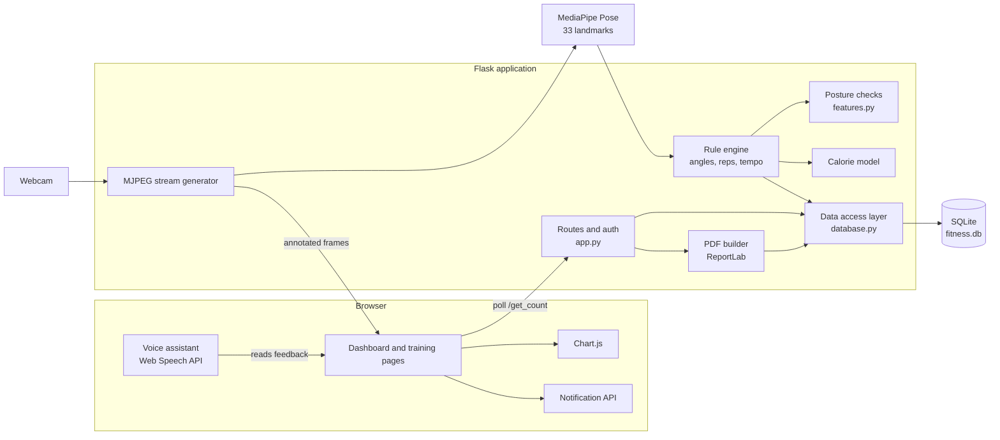
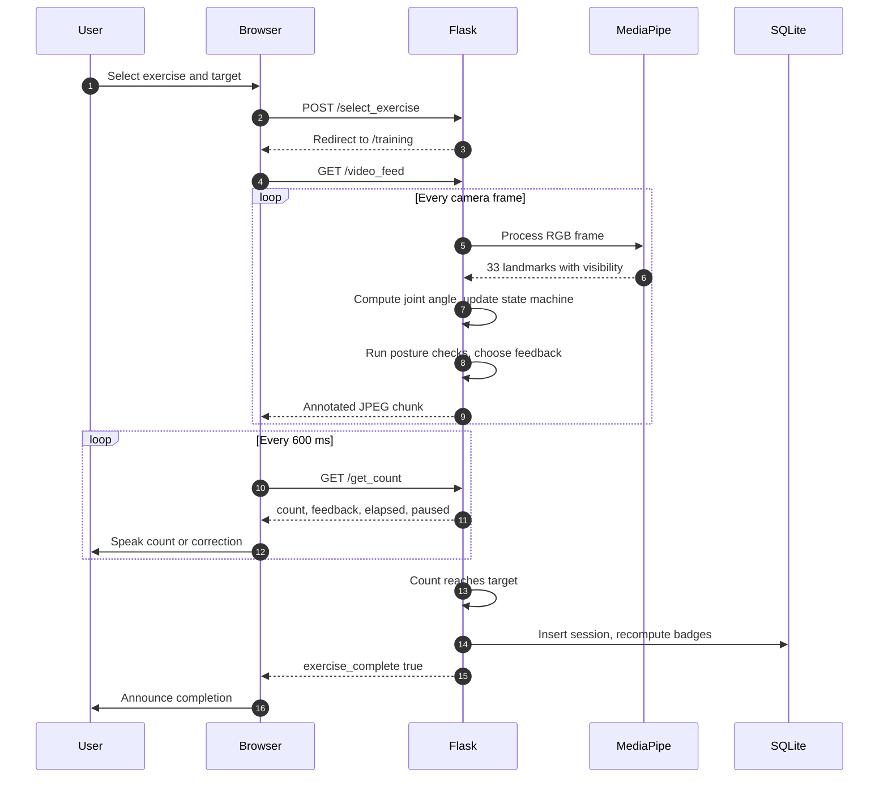
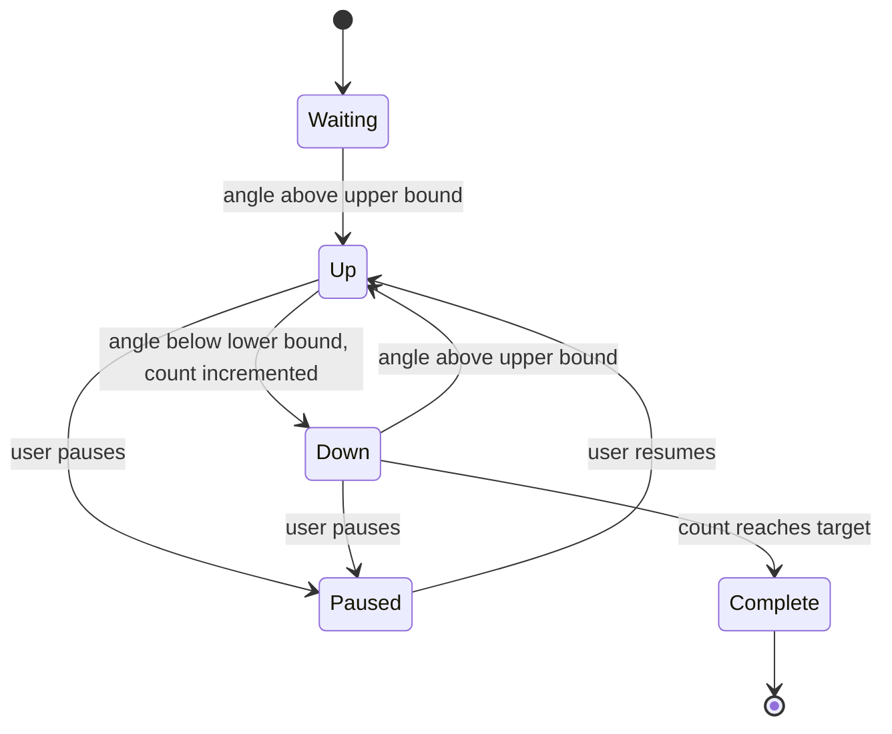
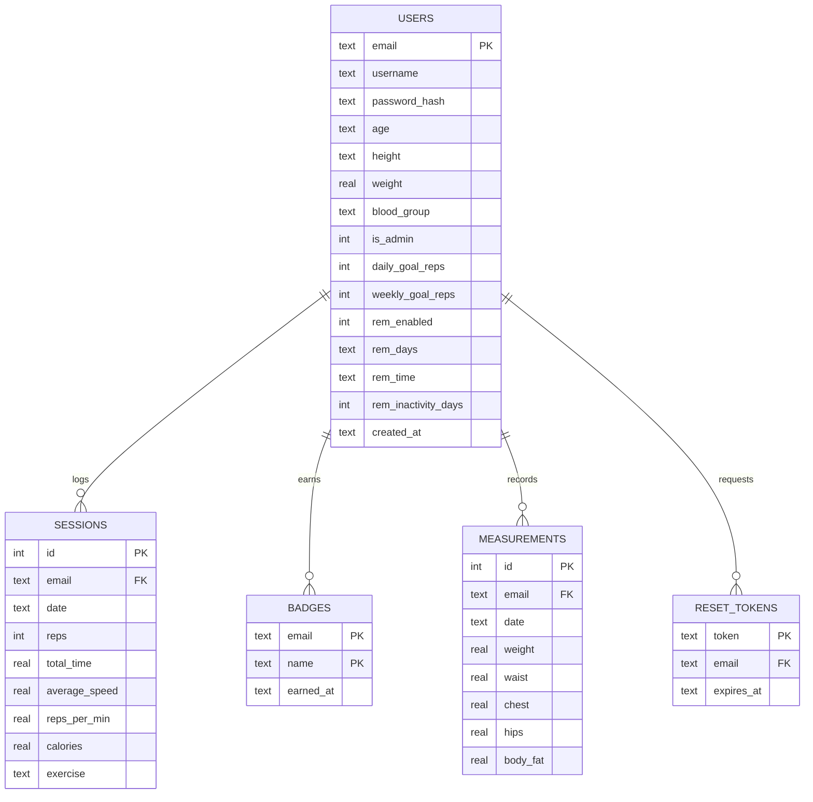
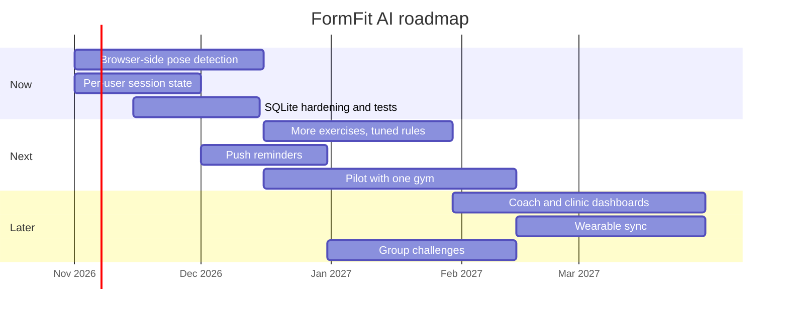

# Physio AI

Real-time exercise tracking and form coaching from an ordinary webcam. PhysioFit AI estimates body pose with MediaPipe, counts repetitions from joint angles, scores tempo, flags posture errors as they happen, and stores progress in a local SQLite database.


---

## Table of contents

1. [Overview](#overview)
2. [Feature matrix](#feature-matrix)
3. [System architecture](#system-architecture)
4. [How a live workout works](#how-a-live-workout-works)
5. [Rep detection and tempo model](#rep-detection-and-tempo-model)
6. [Posture correction rules](#posture-correction-rules)
7. [Calorie estimation model](#calorie-estimation-model)
8. [Data model](#data-model)
9. [HTTP API reference](#http-api-reference)
10. [Project structure](#project-structure)
11. [Installation](#installation)
12. [Configuration](#configuration)
13. [Security notes](#security-notes)
14. [Known limitations](#known-limitations)
15. [Roadmap](#roadmap)
16. [Troubleshooting](#troubleshooting)
17. [Contributing](#contributing)
18. [License](#license)

---

## Overview

Most home workouts have no one watching form, counting reps accurately, or giving feedback. FormFit AI closes that gap with three layers:

| Layer | Responsibility | Implementation |
|---|---|---|
| Perception | Locate 33 body landmarks per frame | MediaPipe Pose |
| Reasoning | Convert landmarks to joint angles, reps, tempo and form verdicts | Transparent rule engine in Python |
| Experience | Live overlay, spoken coaching, dashboards, reports | Flask, Web Speech API, Chart.js, ReportLab |

Design principles:

- **Explainable.** Every correction comes from a readable rule with a documented threshold, not an opaque classifier.
- **Private by default.** Only numeric results are persisted. Video frames are processed in memory and never written to disk.
- **Honest numbers.** Calorie figures are labelled as estimates, and units are consistent (seconds per repetition is the stored unit).

---

## Feature matrix

| Capability | Description | Status |
|---|---|---|
| Live rep counting | Angle-based state machine for knee raises, squats, pushups | Implemented |
| Tempo feedback | Too fast, too slow, good pace per repetition | Implemented |
| AI posture correction | Torso lean, body line and knee alignment checks | Implemented |
| Voice assistant | Spoken counts, instructions, warnings (Web Speech API) | Implemented |
| Streaks and challenges | Current and longest streak, daily goal, weekly challenge, achievements | Implemented |
| Badges | Consistent, Century, Speedster, Calorie Burner, Marathoner, 7-Day Streak | Implemented |
| Body measurements | Weight, waist, body fat with trend chart | Implemented |
| Calorie estimation | MET model adjusted for pace, clearly labelled as an estimate | Implemented |
| Reminders | Schedule plus inactivity nudges via browser notifications | Partial (page must be open) |
| PDF reports | Summary plus filtered session history | Implemented |
| History filters | Exercise, date range, duration, reps, sort order | Implemented |
| Leaderboard | Ranking by total repetitions | Implemented |
| Admin console | Edit, add and delete sessions for any user | Implemented |
| CSV export | Full session history | Implemented |
| Responsive UI | Phone and tablet layouts for dashboards | Implemented for dashboards |
| Multi-user live tracking | Concurrent camera sessions | Not yet (see limitations) |

---

## System architecture



Key design decisions:

- **Short-lived SQLite connections.** Every data access function opens and closes its own connection, so the video thread and request threads never share a connection object. Write-ahead logging is enabled for concurrent readers.
- **Rules before models.** Pose estimation is the only learned component. Counting and form judgment are deterministic and unit-testable.
- **Stateless dashboards.** All dashboard widgets load from JSON endpoints, which keeps the UI replaceable.

---

## How a live workout works



---

## Rep detection and tempo model

Repetitions are counted by a three-state machine driven by one joint angle per exercise. Hysteresis (the threshold band around the target angle) prevents jitter from producing phantom reps.



Per-exercise parameters:

| Exercise | Joints (left side) | Target angle | Threshold | Upper bound | Lower bound | Optimal tempo (s per rep) |
|---|---|---|---|---|---|---|
| Knee raises | hip, knee, ankle | 80 | 25 | 105 | 55 | 1.0 to 2.0 |
| Squats | hip, knee, ankle | 90 | 15 | 105 | 75 | 1.5 to 3.0 |
| Pushups | shoulder, elbow, wrist | 90 | 15 | 105 | 75 | 1.5 to 3.0 |

Angle computation uses the arccosine of the normalized dot product of the two limb vectors meeting at the middle joint, clipped to avoid domain errors.

**Units.** The stored speed value is always seconds per repetition. Repetitions per minute is derived for display only:

```
reps_per_min = 60 / seconds_per_rep
```

A lower seconds-per-rep value means a faster tempo. Tempo guidance defaults to a 1.5 to 3.0 second window for the average across sessions.

---

## Posture correction rules

Checks run each frame after the angle update. They only fire when every landmark they need has visibility above 0.5, so the system stays silent rather than guessing.

| Exercise | Rule | Trigger | Message |
|---|---|---|---|
| Squats | Torso lean from vertical | Greater than 55 degrees | Keep your chest up |
| Squats | Knee to ankle horizontal offset (normalized image units) | Greater than 0.12 | Keep knees stacked over your ankles |
| Pushups | Shoulder, hip, ankle angle | Less than 160 degrees | Keep your body in a straight line |
| Knee raises | Torso lean from vertical | Greater than 20 degrees | Stand tall |

These thresholds are starting points. Camera height, distance and body proportions all shift them, so tune against recordings of your own setup before drawing conclusions.

---

## Calorie estimation model

Calories are an estimate, and the UI labels them as such. The model estimates energy above resting:

```
kcal = (MET - 1) x weight_kg x hours x intensity
intensity = clamp(actual_reps_per_min / reference_reps_per_min, 0.8, 1.3)
```

| Exercise | MET | Reference cadence (reps per min) |
|---|---|---|
| Knee raises | 3.5 | 30 |
| Squats | 5.0 | 20 |
| Pushups | 3.8 | 18 |
| Lunges | 4.5 | 16 |
| Plank | 3.0 | n/a |
| Sit-ups | 3.5 | 20 |
| Jumping jacks | 8.0 | 50 |
| Bicep curls | 3.0 | 18 |
| Shoulder press | 4.0 | 15 |

When no duration is available, the model assumes 3 seconds per repetition. Results ignore age, sex, fitness level and rest periods, so treat them as rough guidance rather than medical data.

---

## Data model



Notes:

- Foreign keys are enforced and cascade on delete and update, so removing a user removes their history.
- `sessions(email, date)` and `measurements(email, date)` are indexed for filter and chart queries.
- Badges are recomputed from the full session history after every save, so editing or deleting a session in the admin console cannot cause double counting.

### Badge rules

| Badge | Condition |
|---|---|
| Consistent | At least 5 sessions |
| Century | At least 100 total repetitions |
| Speedster | A session with 10 or more reps in under 30 seconds |
| Calorie Burner | At least 500 estimated kcal in total |
| Marathoner | A single session with 50 or more reps |
| 7-Day Streak | Longest streak of 7 or more consecutive days |

---

## HTTP API reference

All JSON endpoints require an authenticated session cookie and return `401` otherwise.

### Pages

| Method | Path | Purpose |
|---|---|---|
| GET, POST | `/login`, `/register` | Authentication |
| GET, POST | `/forgot_password`, `/reset_password/<token>` | Password recovery |
| GET | `/profile`, `/dashboard`, `/leaderboard`, `/recommendations` | User views |
| GET, POST | `/edit_profile`, `/manual_log` | Profile and manual workout entry |
| GET, POST | `/select_exercise` | Start a live workout |
| GET | `/training`, `/video_feed` | Live session and MJPEG stream |
| GET | `/export_sessions` | CSV download |
| GET | `/export_pdf` | PDF report, accepts the same filters as `/api/sessions` |

### Live session control

| Method | Path | Body | Response |
|---|---|---|---|
| GET | `/get_count` | none | `count`, `target`, `feedback`, `total_time`, `exercise_complete`, `is_paused` |
| POST | `/set_target` | `{"target": 12}` | `success`, `target` |
| POST | `/pause_resume` | none | `success`, `is_paused` |
| POST | `/save_session` | none | `success` (idempotent per workout) |

### Analytics and tracking

| Method | Path | Notes |
|---|---|---|
| GET | `/api/progress` | Streaks, daily and weekly progress, achievements |
| POST | `/api/goals` | `daily_goal_reps` (1 to 2000), `weekly_goal_reps` (1 to 10000) |
| GET, POST | `/api/measurements` | POST: `weight` (20 to 400 kg), optional `date`, `waist`, `chest`, `hips`, `body_fat` |
| GET, POST | `/api/reminders` | `enabled`, `days` (0 is Monday), `time` (HH:MM), `inactivity_days` |
| GET | `/api/inactivity` | `days_since_last`, `nudge` |
| GET | `/api/sessions` | Filters below |

Session filters for `/api/sessions` and `/export_pdf`:

| Parameter | Type | Meaning |
|---|---|---|
| `exercise` | string | Case-insensitive match, underscores treated as spaces |
| `from`, `to` | date | Inclusive range, `YYYY-MM-DD` |
| `min_reps` | integer | Minimum repetitions |
| `min_time`, `max_time` | number | Duration bounds in seconds |
| `sort` | string | `date_desc`, `date_asc`, `reps_desc`, `time_desc`, `calories_desc` |

Example:

```bash
curl -b cookies.txt \
  "http://127.0.0.1:5000/api/sessions?exercise=squats&from=2026-10-01&min_reps=10&sort=reps_desc"
```

### Administration

| Method | Path | Body |
|---|---|---|
| GET | `/admin` | none |
| POST | `/admin/add_session` | `email`, `date`, `count`, `total_time`, `exercise` |
| POST | `/admin/update_session` | same as above plus `session_index` |
| POST | `/admin/delete_session` | `email`, `session_index` |

Admin routes require `is_admin = 1` on the user record.

---

## Project structure

```text
formfit-ai/
|-- app.py                  Flask routes, auth, live stream, session lifecycle
|-- features.py             Posture rules, calorie model, streaks, goals,
|                           measurements, reminders, PDF, history filters
|-- database.py             SQLite schema and data access layer
|-- requirements.txt
|-- fitness.db              Created on first run (git-ignored)
|-- templates/
|   |-- login.html  register.html  forgot_password.html  reset_password.html
|   |-- profile.html  edit_profile.html  manual_log.html
|   |-- select_exercise.html  training.html
|   |-- leaderboard.html  recommendation.html  admin.html
|   `-- dashboard.html      Progress, goals, measurements, reminders, history
`-- static/
    |-- voice.js            Spoken counts and corrections
    `-- *.png               Exercise images
```

---

## Installation

Requirements: Python 3.10 or newer, a working webcam, and a modern browser (Chrome, Edge or Safari recommended for speech synthesis).

```bash
git clone <your-repository-url> formfit-ai
cd formfit-ai

python -m venv .venv
source .venv/bin/activate          # Windows: .venv\Scripts\activate

pip install -r requirements.txt

export SECRET_KEY="$(python -c 'import secrets; print(secrets.token_hex(32))')"
python app.py
```

Open `http://127.0.0.1:5000`, register an account, then promote it to administrator if needed:

```bash
flask --app app make-admin you@example.com
```

Add the voice assistant to `templates/training.html` just before the closing body tag:

```html
<button id="voiceToggle" type="button">Voice: on</button>
<script src="{{ url_for('static', filename='voice.js') }}"></script>
```

---

## Configuration

| Variable | Default | Purpose |
|---|---|---|
| `SECRET_KEY` | development placeholder | Signs session cookies. Always set in production. |
| `DATABASE_PATH` | `./fitness.db` | Location of the SQLite file |
| `ADMIN_EMAIL` | unset | Account that receives administrator rights on registration |

Tunable constants live in code: exercise definitions and tempo windows in `app.py`, posture thresholds and calorie tables in `features.py`.

---

## Security notes

- Passwords are stored only as salted hashes (Werkzeug). Plaintext passwords are never persisted.
- Administrator access is a database flag, not a username comparison.
- Password reset tokens are random, expire after one hour, and are single use. Without an email provider configured, the reset link is written to the server log, so wire up SMTP before exposing the app.
- Session cookies should be served over HTTPS in production, with `SESSION_COOKIE_SECURE` and `SESSION_COOKIE_HTTPONLY` enabled.
- Camera frames are processed in memory only. Nothing about the image is stored.
- `/debug_session` is available only when Flask debug mode is on. Never run with `debug=True` on a public host.
- Add rate limiting (for example Flask-Limiter) to login and reset endpoints before public deployment.

---

## Known limitations

| Limitation | Impact | Planned fix |
|---|---|---|
| Server reads the machine webcam | Phones show the server camera, not their own | Run MediaPipe in the browser |
| Live workout state is global | One live user at a time | Per-session state, ideally client-side |
| Reminders need the page open | No background alerts | Web push or Firebase Cloud Messaging |
| Left-side landmarks only | Wrong side facing the camera can reduce accuracy | Automatic side selection by visibility |
| Fixed thresholds | Camera angle and body proportions affect results | Per-user calibration |
| Calories are estimates | Not suitable for medical decisions | Optional heart rate integration |

---

## Roadmap



---

## Troubleshooting

| Symptom | Likely cause | Fix |
|---|---|---|
| Black video panel | Camera in use by another app, or wrong index | Close other apps, or change `cv2.VideoCapture(0)` to another index |
| "Ensure all joints are visible" never clears | Subject too close, left side hidden | Step back so the whole left side is in frame, face the camera sideways |
| Reps double counted | Threshold band too narrow for your movement | Increase the exercise `threshold` value |
| No voice | Browser blocks speech until a user gesture | Click the voice toggle once, or any page element |
| `database is locked` | Long external process holding the file | Close other tools opened on `fitness.db`, keep WAL mode enabled |
| PDF route returns 500 | ReportLab missing | `pip install reportlab` |
| Notifications never appear | Permission not granted | Allow notifications for the site and keep the dashboard open |

---

## Contributing

1. Fork the repository and create a feature branch.
2. Keep rules deterministic and add a test that feeds synthetic landmarks to any new posture check.
3. Keep stored units consistent: seconds per repetition, kilograms, centimetres.
4. Open a pull request describing the change and how it was validated.

Suggested checks before submitting:

```bash
python -m py_compile app.py features.py database.py
python -m pytest            # once tests are added
```

---

## License

Choose and add a license before publishing, for example MIT or Apache-2.0, and place it in a `LICENSE` file at the repository root.
