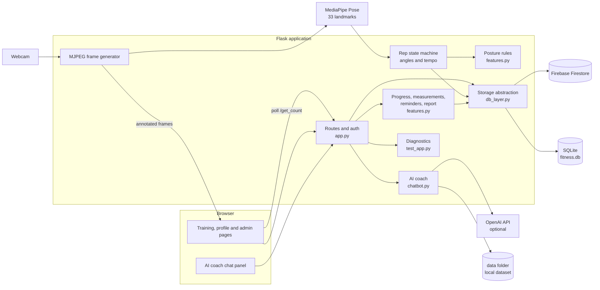
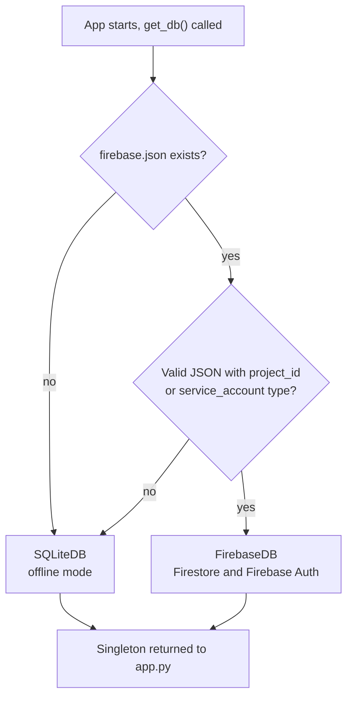
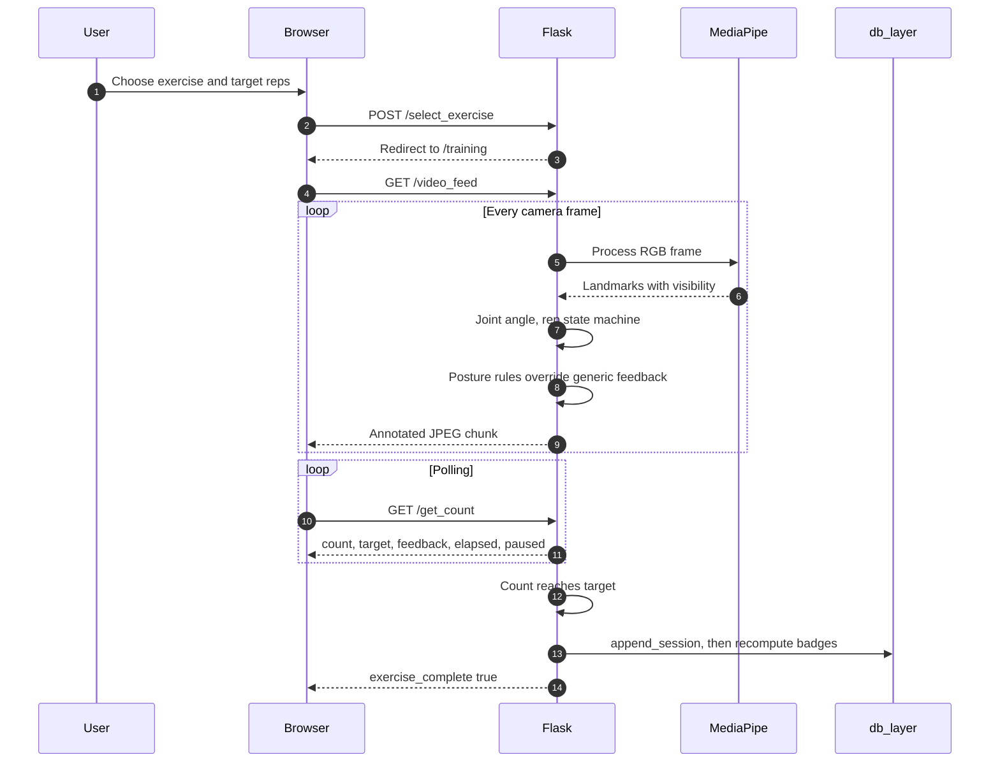
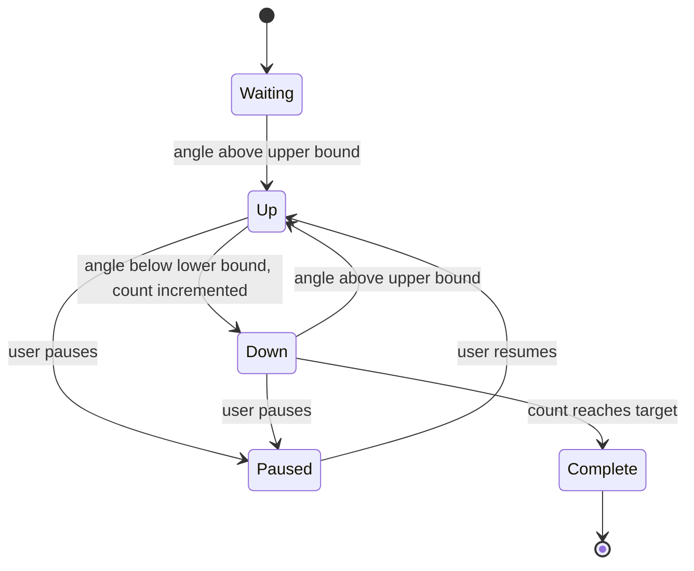
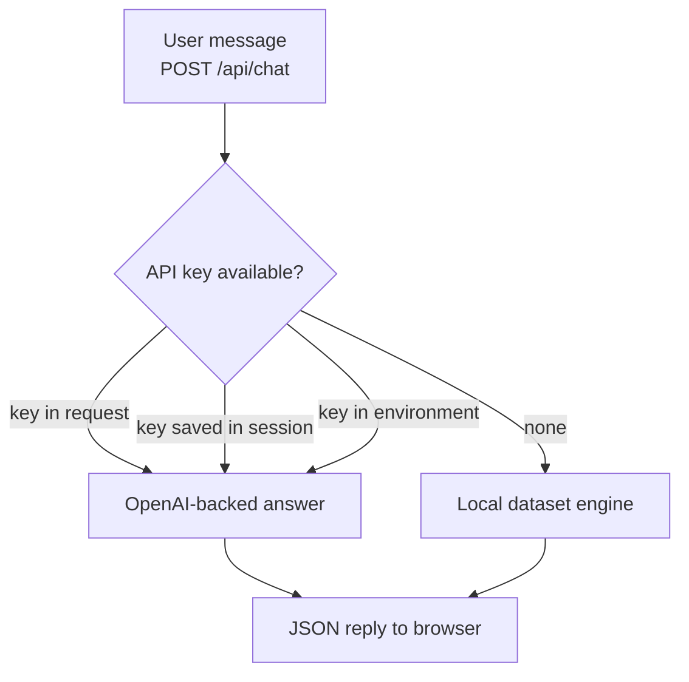
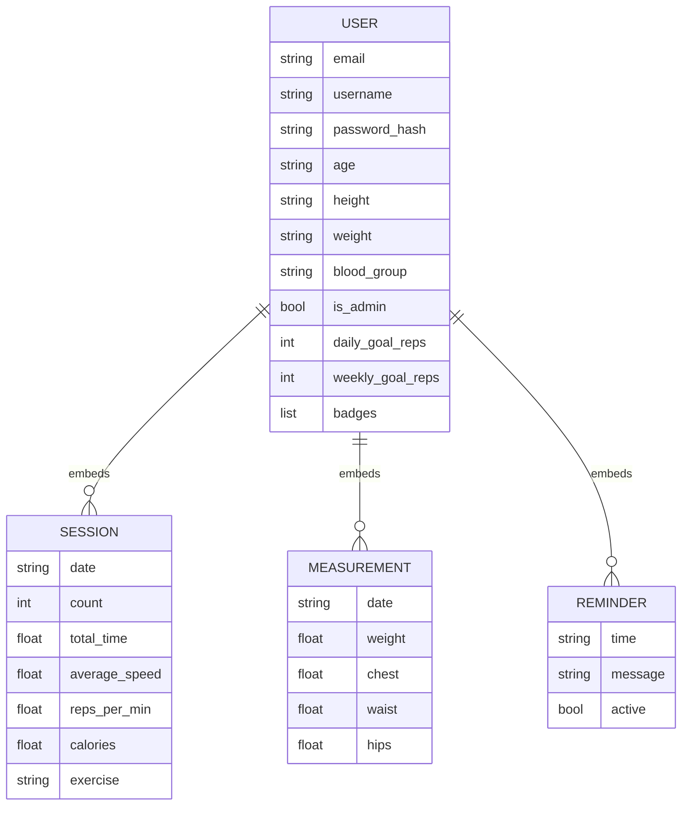
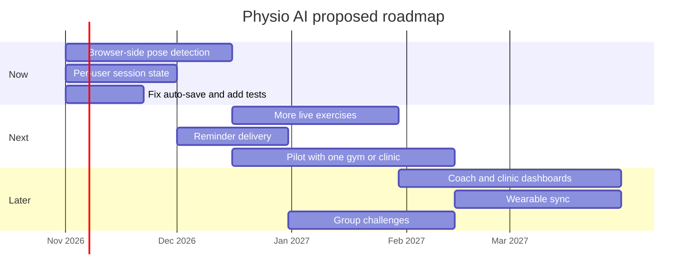

# Physio AI

Real-time exercise tracking and form coaching from an ordinary webcam. Physio AI estimates body pose with MediaPipe, counts repetitions from joint angles, scores tempo, flags posture errors while you move, and keeps your progress in either Firebase Firestore or a local SQLite file, chosen automatically at startup.

Repository: https://github.com/Alexjmathew/AIBOOMI


---

## Table of contents

1. [Overview](#overview)
2. [Feature matrix](#feature-matrix)
3. [System architecture](#system-architecture)
4. [Storage backends](#storage-backends)
5. [How a live workout works](#how-a-live-workout-works)
6. [Rep detection and tempo](#rep-detection-and-tempo)
7. [Posture correction rules](#posture-correction-rules)
8. [Calorie estimation](#calorie-estimation)
9. [AI coach](#ai-coach)
10. [Data model](#data-model)
11. [Gamification](#gamification)
12. [Route reference](#route-reference)
13. [Project structure](#project-structure)
14. [Installation](#installation)
15. [Configuration](#configuration)
16. [Diagnostics and testing](#diagnostics-and-testing)
17. [Security notes](#security-notes)
18. [Known limitations](#known-limitations)
19. [Proposed roadmap](#proposed-roadmap)
20. [Troubleshooting](#troubleshooting)
21. [Contributing](#contributing)
22. [License](#license)

---

## Overview

Home workouts rarely have anyone watching your form, counting reps accurately or giving feedback. Physio AI adds three layers on top of a normal webcam:

| Layer | Responsibility | Implementation |
|---|---|---|
| Perception | Locate 33 body landmarks per frame | MediaPipe Pose |
| Reasoning | Joint angles, rep counting, tempo and form verdicts | Rule engine in `app.py` and `features.py` |
| Experience | Live overlay, dashboards, AI coach chat, admin tools | Flask, Jinja templates, optional OpenAI integration |

Design principles:

- **Explainable.** Every correction comes from a readable rule with a documented threshold.
- **Private by default.** Only numeric results are stored. Camera frames are processed in memory and never written to disk.
- **Runs anywhere.** With no cloud credentials the app falls back to a local SQLite file, so it works offline.

---

## Feature matrix

| Capability | Description | Status |
|---|---|---|
| Live rep counting | Angle-based state machine for knee raises, squats, pushups | Implemented |
| Tempo feedback | Too fast, too slow or good pace per repetition | Implemented |
| Posture correction | Rules for squats, pushups, knee raises and lunges | Implemented |
| Manual logging | Nine exercises including those without live tracking | Implemented |
| Calorie estimate | MET x weight x time | Implemented |
| Streaks and badges | Current and longest streak, six badges | Implemented |
| Leaderboard | Ranked by total repetitions, shows streak and badge count | Implemented |
| Body measurements | Weight, chest, waist, hips log | Implemented |
| Reminders | Stores reminder time and message | Stored only, no delivery yet |
| Progress page | Totals for reps, calories, time, streaks | Implemented |
| Report download | Session history as a plain-text file | Implemented (text, not PDF) |
| CSV export | Full session history | Implemented |
| AI coach chat | Local dataset engine, optional OpenAI key | Implemented |
| Admin console | Add users, add, edit, delete sessions | Implemented |
| Admin diagnostics | Runs the test suite and shows system status in the browser | Implemented |
| Dual storage | Firestore when credentials exist, SQLite otherwise | Implemented |
| Multi-user live tracking | Concurrent camera sessions | Not supported |

---

## System architecture



---

## Storage backends

`db_layer.py` exposes one interface and picks the backend once at startup.



Shared interface used by every route:

| Method | Purpose |
|---|---|
| `get_user(email)` | Return the user dict or `None` |
| `set_user(email, data)` | Create or overwrite |
| `update_user(email, data)` | Partial merge update |
| `user_exists(email)` | Boolean check |
| `all_users()` | List all users, password fields removed |
| `append_session(email, session)` | Add one workout |
| `update_sessions(email, sessions)` | Replace the full session list |
| `update_badges(email, badges)` | Replace badges |
| `delete_field(email, field)` | Remove a top-level field |

Behaviour differences:

| Concern | Firebase mode | SQLite mode |
|---|---|---|
| Storage shape | One Firestore document per user | One row per user, whole user stored as JSON in a `data` column |
| Auth accounts | Firebase Auth user is created alongside the document | No separate account, login uses the stored password hash only |
| Password reset | Generates a reset link (you must email it) | Not available, the page says so |
| Concurrency | Firestore handles it | Read, modify, write of the whole document, so simultaneous writes to one user can overwrite each other |

---

## How a live workout works



---

## Rep detection and tempo

A rep is counted when the tracked joint angle goes above the upper bound (position becomes up) and then drops below the lower bound. The band between the bounds prevents jitter from creating extra reps. The workout timer starts on the first counted rep, so setup time is not included.



Live exercises, as defined in `EXERCISES` in `app.py`:

| Exercise | Joints (left side) | Target angle | Threshold | Upper bound | Lower bound | Good tempo (seconds per rep) |
|---|---|---|---|---|---|---|
| Knee Raises | hip, knee, ankle | 80 | 25 | 105 | 55 | 1.0 to 2.0 |
| Squats | hip, knee, ankle | 90 | 15 | 105 | 75 | 1.5 to 3.0 |
| Pushups | shoulder, elbow, wrist | 90 | 15 | 105 | 75 | 1.5 to 3.0 |

All three joints must have visibility above 0.5, otherwise the overlay asks the user to make every joint visible.

Manual logging also accepts lunges, plank, sit-ups, jumping jacks, bicep curls and shoulder press.

**Units.** Speed is always stored as seconds per repetition (`average_speed`). Reps per minute is derived as `60 / seconds_per_rep` and stored as `reps_per_min`.

The recommendations page averages `average_speed` across sessions and maps it to advice:

| Average seconds per rep | Message |
|---|---|
| Below 0.8 | Very fast, slow down for form and injury risk |
| 0.8 to below 1.5 | Fast, slow slightly |
| 1.5 to 3.0 | Excellent pace |
| Above 3.0 to 5.0 | Moderate, pick up the tempo |
| Above 5.0 | Slow, gradually increase speed |

---

## Posture correction rules

Rules live in `features.py` and run every frame after the angle update. A rule stays silent unless the landmarks it needs have visibility above 0.4. Coordinates are normalized image units (x to the right, y downward).

| Exercise | Condition | Message |
|---|---|---|
| Squats | Left knee x is more than 0.08 beyond left ankle x | Keep your knees behind your toes |
| Squats | Shoulder x and hip x differ by more than 0.12 | Keep your back straight, do not lean too far forward |
| Pushups | Hip y is more than 0.05 above the shoulder to ankle midpoint | Lower your hips, keep your body in a straight line |
| Pushups | Hip y is more than 0.05 below that midpoint | Raise your hips, avoid sagging |
| Knee raises | Knee y is more than 0.05 below hip y | Lift your knee higher for full range of motion |
| Lunges | Left knee x is more than 0.08 beyond left ankle x | Keep your front knee behind your toes |

Lunges have a posture rule but are not yet available as a live-tracked exercise. These thresholds depend on camera angle and which side faces the camera, so tune them against your own setup.

---

## Calorie estimation

Calories are an estimate. The model is deliberately simple:

```
kcal = MET x weight_kg x (total_time_seconds / 3600)
```

| Exercise | MET |
|---|---|
| Knee raises | 3.5 |
| Squats | 5.0 |
| Pushups | 4.0 |
| Lunges | 4.5 |
| Plank | 3.0 |
| Sit-ups | 4.0 |
| Jumping jacks | 8.0 |
| Bicep curls | 3.0 |
| Shoulder press | 4.0 |
| Any other exercise | 4.0 |

Weight comes from the user profile and defaults to 70 kg when missing or invalid. The formula counts total energy rather than energy above resting, ignores rep count and pace, and does not account for age, sex or fitness level, so treat it as rough guidance.

---

## AI coach

The profile page includes a chat panel backed by `chatbot.py`.



- Key priority is the request body, then the key saved in the session, then an environment variable.
- `POST /api/set_openai_key` saves or clears a key for the current session. Sending an empty key reverts to the local engine.
- The coach receives the user's profile and recent chat history as context.

---

## Data model

Users are stored as one document. In SQLite mode the same structure is serialized as JSON in a single column.



Notes:

- The admin console addresses sessions by their position in the list, so deleting a session shifts the indexes of the ones after it.
- Registration stores profile fields as strings straight from the form. Weight is converted to a number when calories are calculated.
- Old accounts that still have a plaintext `password` field are upgraded to a hash on next login, and the plaintext field is removed.

---

## Gamification

Badges are recomputed from the full session history after every save, so edits and deletions cannot double count.

| Badge | Condition |
|---|---|
| Consistent | At least 5 sessions |
| Century | At least 100 total repetitions |
| Speedster | A session with 10 or more reps in under 30 seconds |
| Calorie Burner | At least 500 estimated kcal in total |
| Marathoner | A single session with 50 or more reps |
| 7-Day Streak | Longest streak of 7 or more consecutive days |

The current streak counts consecutive days with at least one session, ending today or yesterday. The longest streak is the best run in the full history. Default goals are 20 reps per day and 150 reps per week, stored on the user.

---

## Route reference

### Account and pages

| Method | Path | Purpose |
|---|---|---|
| GET, POST | `/login`, `/register` | Authentication |
| GET, POST | `/forgot_password` | Password reset (Firebase mode only) |
| GET | `/logout` | Clears state and session |
| GET | `/profile`, `/dashboard`, `/leaderboard`, `/recommendations` | User views |
| GET, POST | `/edit_profile`, `/manual_log` | Profile and manual workout entry |
| GET | `/export_sessions` | CSV download |
| GET | `/progress` | Totals and streaks |
| GET, POST | `/measurements` | Body measurement log |
| GET, POST | `/reminders` | Reminder entries |
| GET | `/pdf_report` | Session history as a plain-text download |

### Live workout

| Method | Path | Purpose |
|---|---|---|
| GET, POST | `/select_exercise` | Choose exercise and target |
| GET | `/training` | Live session page |
| GET | `/video_feed` | MJPEG stream with overlays |
| GET | `/get_count` | JSON: `count`, `target`, `feedback`, `total_time`, `exercise_complete`, `is_paused` |
| POST | `/set_target` | JSON body `{"target": 12}`, resets the session |
| POST | `/pause_resume` | Toggle pause |
| POST | `/save_session` | Save the workout, safe to call twice |

### AI coach

| Method | Path | Body |
|---|---|---|
| POST | `/api/chat` | `message`, optional `history`, optional `api_key` |
| POST | `/api/set_openai_key` | `api_key` (empty clears) |

### Administration

All admin routes require `is_admin` on the signed-in user.

| Method | Path | Purpose |
|---|---|---|
| GET | `/admin` | User and session overview |
| POST | `/admin/add_user` | `email`, `username`, `password`, optional profile fields and `is_admin` |
| POST | `/admin/add_session` | `email`, `date`, `count`, `total_time`, `exercise` |
| POST | `/admin/update_session` | Same plus `session_index` |
| POST | `/admin/delete_session` | `email`, `session_index` |
| GET | `/admin/tests` | Run diagnostics and render results |
| POST | `/admin/run_tests_api` | Run diagnostics and return JSON |

`/debug_session` returns the session contents but only while Flask debug mode is on.

---

## Project structure

```text
AIBOOMI/
|-- app.py            Routes, auth, live stream, rep state machine, admin
|-- db_layer.py       Firestore or SQLite storage abstraction
|-- features.py       Posture rules, calories, streaks, speed advice,
|                     progress, measurements, reminders, report routes
|-- chatbot.py        AI coach (referenced by app.py)
|-- test_app.py       Test suite and system diagnostics
|-- data/             Data used by the project (local coach dataset)
|-- static/           Exercise images and assets
|-- templates/        Pages referenced by routes:
|                     login, register, forgot_password, profile, edit_profile,
|                     dashboard, manual_log, select_exercise, training,
|                     leaderboard, recommendation, progress, measurements,
|                     reminders, admin, admin_tests
|-- .env              Local secrets (never commit)
|-- firebase.json     Optional Firebase service account (never commit)
|-- fitness.db        Created automatically in SQLite mode
```

---

## Installation

Requirements: Python 3.10 or newer, a webcam, and a modern browser.

```bash
git clone https://github.com/Alexjmathew/AIBOOMI.git
cd AIBOOMI

python -m venv .venv
source .venv/bin/activate          # Windows: .venv\Scripts\activate

pip install flask opencv-python mediapipe numpy pandas python-dotenv werkzeug
```

Install optional extras only if you use them:

```bash
pip install firebase-admin         # only for Firebase mode
pip install openai                 # only if chatbot.py uses the OpenAI SDK
```

Create a `.env` file in the project root:

```bash
SECRET_KEY=replace-with-a-long-random-string
```

Run it:

```bash
python app.py
```

Open http://127.0.0.1:5000 and register an account. With no `firebase.json` present, the console prints that SQLite offline mode is active and creates `fitness.db`.

### Creating the first administrator

New accounts are not admins. Promote one from a Python shell in the project folder:

```python
from db_layer import get_db
get_db().update_user("you@example.com", {"is_admin": True})
```

Log out and back in for the change to take effect. After that, admins can create more users from the admin console.

---

## Configuration

| Setting | Where | Purpose |
|---|---|---|
| `SECRET_KEY` | `.env` | Signs session cookies. Falls back to an insecure development value if unset. |
| OpenAI key | Environment variable, session or request | Enables OpenAI answers in the coach. Check `chatbot.py` for the exact variable name. |
| `firebase.json` | Project root | Presence of a valid service account switches storage to Firebase |
| `fitness.db` | Project root | SQLite file used when Firebase is not configured |

Exercise definitions and tempo windows are in `EXERCISES` in `app.py`. Posture thresholds, MET values and speed advice ranges are in `features.py`.

---

## Diagnostics and testing

Admins can open `/admin/tests` to run the suite in `test_app.py` from the browser. The page shows total, passed and failed counts, pass rate, total duration and system diagnostics. `/admin/run_tests_api` returns the same data as JSON for scripts.

Guidelines for new tests:

- Feed synthetic landmarks to each posture rule, including a case with low visibility that must return nothing.
- Test streak logic around month boundaries and with a gap of exactly one day.
- Run the suite once in each storage mode.

---

## Security notes

- Passwords are stored only as salted hashes. Legacy plaintext values are upgraded on login.
- Administrator access is a flag on the user record, not a username check.
- Keep `.env` and `firebase.json` out of version control. Add both to `.gitignore`, and rotate any key that was ever committed.
- Set a real `SECRET_KEY`. The built-in fallback is public.
- Flask session cookies are signed, not encrypted. An OpenAI key saved with `/api/set_openai_key` lives in that cookie, so use HTTPS in any shared deployment or move keys to server-side sessions.
- Forms and JSON endpoints do not use CSRF tokens. Add Flask-WTF or similar before public deployment.
- Add rate limiting to `/login` and `/register`.
- Never run with `debug=True` on a public host.
- Camera frames are processed in memory only.

---

## Known limitations

| Limitation | Impact | Possible fix |
|---|---|---|
| Server reads the machine webcam | Phones show the server camera, not their own | Run MediaPipe in the browser |
| Live workout state is global | One live user at a time | Per-session state |
| Auto-save runs inside the video generator and reads the Flask session | It can fail outside a request context, in which case use the Save button, which calls `/save_session` | Capture the email in `/video_feed` and pass it in, or use `stream_with_context` |
| SQLite stores each user as one JSON blob | No SQL queries on sessions, and concurrent writes can overwrite each other | Move to relational tables |
| Reminders are stored but never delivered | No notifications | Browser notifications or push |
| Report download is plain text | Not a formatted PDF | Generate a real PDF |
| Left-side landmarks only | Lower accuracy if the right side faces the camera | Pick the more visible side |
| Fixed thresholds | Camera angle and body proportions change results | Per-user calibration |
| Calories are rough | Not medical data | Pace and heart rate inputs |

---

## Proposed roadmap



---

## Troubleshooting

| Symptom | Likely cause | Fix |
|---|---|---|
| Black video panel | Camera busy or wrong device index | Close other apps, or change `cv2.VideoCapture(0)` |
| "Ensure all joints are visible" never clears | Left side of the body is hidden | Stand sideways with the whole left side in frame |
| Reps double counted or missed | Threshold band does not fit your range of motion | Adjust `threshold` for that exercise |
| Workout finished but not in history | Auto-save failed | Press save, or check the server log for a pose processing error |
| "Password reset is not available in offline mode" | SQLite mode has no email support | Use Firebase mode with an email sender, or reset through an admin |
| Cannot open `/admin` | Account is not an admin | Promote it as shown in Installation |
| Dashboard widgets empty | Template calls endpoints that the backend does not define | Compare the fetch URLs in `dashboard.html` with the routes above |
| `database is locked` | Another process holds `fitness.db` | Close other tools that opened it |

---

## Contributing

1. Fork the repository and create a feature branch.
2. Keep rules deterministic and add a test for each new posture rule.
3. Keep stored units consistent: seconds per repetition, kilograms.
4. Run the diagnostics page before opening a pull request, in both storage modes if you touched `db_layer.py`.

---

## License

No license file was found in the repository. Add one, for example MIT or Apache-2.0, as `LICENSE` at the project root before sharing the code publicly.
